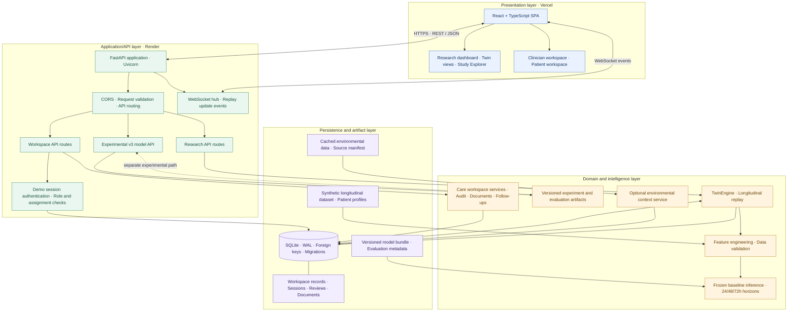
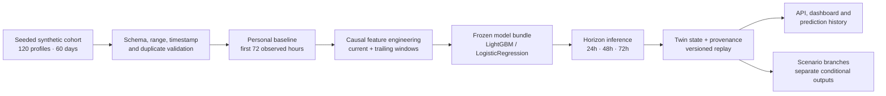

# PranaGuard — Patient-Specific COPD Digital-Twin Workspace

**Happiest Health Digital Twin Challenge 2026 · Engineering prototype and research submission**  
**Institution:** Pune Institute of Computer Technology (PICT), Pune

> PranaGuard is a synthetic-data research prototype combining longitudinal patient-twin replay, experimental multi-horizon risk visibility, model-study evidence, environmental context, and connected doctor–patient care workflows. It makes data coverage, model versions, provenance, assumptions and review actions inspectable; it does not make autonomous clinical decisions.

<p align="center">
  <a href="https://prana-guard-copd-digital-twin.vercel.app"><strong>Open live demo</strong></a> ·
  <a href="https://pranaguard-api.onrender.com/api/health"><strong>Backend health</strong></a> ·
  <a href="https://github.com/harshtakalkar037-boop/PranaGuard-COPD-Digital-Twin"><strong>Source repository</strong></a>
</p>

> [!CAUTION]
> **Research demonstration only. Not a medical device. Not clinically validated.** All patient identities and records are synthetic. Model outputs are experimental estimates on generated data and must not be used for diagnosis, triage, prescribing, treatment, emergency decisions, or claims of patient benefit. No real patient, hospital/EHR, or certified medical-device integration is provided.

---

## 1. The problem we are exploring

COPD status can change over time. A single measurement may not describe the context of a person's symptoms, daily records, baseline, or environmental conditions.

PranaGuard explores whether a patient-specific digital-twin workspace can make longitudinal signals, experimental risk estimates, model evidence, and care-team review easier to inspect in one connected experience. The prototype demonstrates that workflow on a frozen synthetic research cohort; it does not demonstrate reliable prediction of real COPD exacerbations or improved clinical outcomes.

## 2. What makes PranaGuard different

- **Stateful twin, not just a static dashboard:** replayable, versioned patient states and longitudinal history.
- **Visible research evidence:** model versions, experiment comparisons, evaluation results, limitations, and provenance are surfaced rather than hidden behind one score.
- **Connected doctor and patient workflows:** patient-submitted records can be reviewed by an assigned doctor; doctor-shared documents and follow-ups appear in the linked patient account.
- **Server-side access rules:** role and patient-assignment checks are enforced by the API, not only by hiding interface elements.
- **Honest missing-data handling:** surfaces show coverage, freshness, completeness, and empty states rather than inventing values.
- **Environmental context is separate from model inference:** optional city context is displayed separately and is not silently inserted into the frozen model inputs.
- **Additive evolution:** care-workspace and v6 capabilities extend the original twin, replay, alert, and study-explorer experience.

## 3. Live prototype and submission resources

| Resource | Link |
|---|---|
| Live web application | [PranaGuard dashboard](https://prana-guard-copd-digital-twin.vercel.app) |
| Backend health endpoint | [API health](https://pranaguard-api.onrender.com/api/health) |
| FastAPI interactive docs | [API docs](https://pranaguard-api.onrender.com/docs) |
| Source code | [GitHub repository](https://github.com/harshtakalkar037-boop/PranaGuard-COPD-Digital-Twin) |
| Doctor–patient delivery report | [DOCTOR_PATIENT_DELIVERY.md](docs/DOCTOR_PATIENT_DELIVERY.md) |
| v6 implementation report | [ENHANCEMENT_IMPLEMENTATION_REPORT.md](docs/ENHANCEMENT_IMPLEMENTATION_REPORT.md) |
| v6 acceptance evidence | [V6_ACCEPTANCE.md](docs/v6-verification/V6_ACCEPTANCE.md) |

The public frontend is hosted on Vercel and the FastAPI backend on Render. The currently audited Render API uses the Free plan and a local SQLite file. **Do not assume user-created demo records survive service restarts, redeployments, or filesystem resets.** This hosting configuration is for demonstration only and must never receive real patient information.

## 4. Jury walkthrough: recommended 5–7 minute flow

1. **Start at login.** Explain that the accounts are fictional demo identities and that the app has separate doctor and patient experiences.
2. **Open the doctor workspace.** Show grouped navigation, the synthetic patient directory, search, and the Care Action Centre.
3. **Open a patient profile.** Review the twin overview, baseline, historical state, sputum information, care plan, review history, and model-risk context.
4. **Explain risk evidence carefully.** Show 24/48/72-hour replay-model outputs with timestamps, model version, input completeness, freshness, review status, and explanation limitations. Do not call these clinically validated probabilities.
5. **Demonstrate the connected patient account.** Sign out and sign in as the linked patient. Add or inspect a daily wellbeing entry, sputum diary, and medication-adherence report.
6. **Return to the doctor account.** Show the same patient-submitted record, mark it reviewed, and demonstrate the audit trail.
7. **Show doctor-to-patient actions.** Share a fictional document or follow-up instruction, then show the linked patient view and authorized document access.
8. **Finish with Insights and Study Explorer.** Highlight date filters, honest missing-data states, experiment comparisons, and explicit model limitations.

### Demo identities and login instructions

Use these accounts for the current deployed workspace. They are public synthetic demonstration credentials, not production credentials. Passwords may be overridden with environment variables before the first database seed.

| Role | Username | Demo password | Experience |
|---|---|---|---|
| Doctor | `dr-atlas` | `prana-atlas-demo` | Doctor account with the synthetic cohort |
| Doctor (isolation demo) | `dr-nova` | `prana-nova-demo` | Empty doctor panel for assignment/isolation demonstration |
| Patient | `pat-pg0071` | `prana-patient-demo` | Patient account linked to synthetic patient PG-0071 |

**Legacy login note:** `pg_doctor_demo` was used by an older version of the project. It is not seeded/supported by the current workspace source; use `dr-atlas` for the doctor demonstration. The old password could not be confirmed, so it is intentionally not listed as a working credential.

Sessions use bearer tokens, PBKDF2 password hashes, and a 12-hour expiry. This is demo-grade authentication, not production identity management.

### 4.1 Product walkthrough and visual evidence

The live application is the source of truth for the current interface: [open the PranaGuard demo](https://prana-guard-copd-digital-twin.vercel.app). The repository currently has no checked-in, verified UI screenshot set, so this README does not embed mockups or generated screenshots in place of the running product.

| Area to inspect | What the walkthrough demonstrates |
|---|---|
| Research overview | Synthetic cohort status, risk grouping, replay context, and system-level summaries. |
| Patient digital twin | Personal baseline, current synthetic state, longitudinal history, and missing-data context. |
| Model risk and evidence | 24h/48h/72h baseline outputs, separately labelled v3 48h experiment, model version, and limitations. |
| Clinician workspace | Assigned synthetic patient directory, patient profile, review queue, action history, and follow-ups. |
| Patient workspace | Daily wellbeing, sputum diary, adherence entries, and shared clinical documents. |
| Notifications and environment | Notification review lifecycle, source/freshness context, and optional city-level environmental data. |

Screenshots should be captured from the deployed application using the public demo accounts and added under a dedicated `docs/screenshots/` directory only after checking that they contain no real personal information or session tokens. This keeps the visual evidence authentic and reproducible.


## 5. Feature set

### 5.1 Original digital-twin and research dashboard

- Frozen synthetic cohort with **120 patient profiles and 3,000 stored twin/window states**.
- Cohort overview, patient search, risk categories, and patient-specific views.
- Longitudinal twin-state history, versioned replay, and live dashboard updates through WebSockets.
- Baseline/current-state inspection, signal trends, and missingness/freshness context.
- Model inference and explanation surfaces for the frozen baseline pipeline.
- Scenario studio for conditional PM2.5, adherence, and activity assumptions.
- Persisted alerts, acknowledgement/resolution workflow, and clinician action notes.
- Data-integrity checks, cohort/model fingerprints, provenance manifests, and reproducible artifacts.

The frozen cohort is read-only research data. Demo write flows are designed to touch workspace tables, not rewrite the frozen scientific dataset.

### 5.2 Model-study and evidence explorer

- Versioned experiment history, gates, rollups, ablations, top-five summaries, leaderboard, scatter plots, and model comparisons.
- Experiment v2 (6-hour personalized) is rejected and retained as evidence, not presented as active.
- Experiment v3 (`pg48-v3-multiseed`) is an active experimental 48-hour early-warning model with its own frozen-gate evidence.
- v4 evidence, gap analysis, final selection report, and TreeSHAP cache are retained and integrity-checked.
- v5 study explorer presents frozen-versus-active comparisons without overwriting prior study results.

### 5.3 Clinician workspace and connected patient experience

- Signed-in clinician workspace, unified patient directory, onboarding, patient 360° profile, and persisted Care Action Centre review workflow.
- Patient daily wellbeing log, sputum diary, and medication adherence with audited corrections.
- Doctor-reviewed flags, clinical document upload/share with SHA-256 provenance, follow-up instructions, and uniform audit trail.
- Patient home summary and patient insights for symptoms/breathlessness/cough, replay breathing rate, sleep, activity, hydration, adherence, and wellbeing.
- 7/30/90-day and custom date filters, with explicit empty states where replay data is unavailable.
- Exactly three patient navigation items: Patient Home, My Health Records, and Clinical Documents.

### 5.4 v6: doctor risk visibility and patient insights

- Doctor risk cards for 24/48/72-hour horizons, including prediction timestamp, model version, data completeness, freshness, and review status.
- 72-hour watchlist and patient-profile Model Risk tab, plus timestamped prediction history.
- Feature-contribution view reuses the existing frozen engine explanation path.
- Patient insights and home summaries are data-backed and preserve honest missing-data states.
- Patient sessions are blocked with HTTP 403 from doctor-only prediction endpoints.
- All risk outputs are labelled as experimental synthetic-data estimates and not intended for diagnosis, triage, or treatment decisions.

## 6. System architecture and technology

PranaGuard follows a **layered client–API–domain–data architecture**. The browser application presents separate research, clinician, and patient experiences. A FastAPI service exposes the research and care-workspace APIs, while the digital-twin engine, model artifacts, and persistence layer remain on the backend. The architecture keeps the synthetic research replay distinct from user-entered demo care-workspace records and optional environmental context.

### 6.1 High-level system architecture

The following diagram is maintained as Mermaid source in this README, so the architecture remains version-controlled and editable alongside the implementation.



### 6.2 Layer responsibilities

| Layer / component | Responsibility |
|---|---|
| **Presentation — React SPA** | Renders the research dashboard, patient twin views, study explorer, clinician workspace, and patient workspace. Uses shared API configuration for backend requests. |
| **API — FastAPI** | Hosts REST endpoints, request/response validation, CORS configuration, application lifecycle, and route composition. Uvicorn runs the service. |
| **Research API** | Exposes cohort, patient, history, replay, scenario, alert, and research-evidence operations over the synthetic twin. |
| **Experimental model API** | Exposes the separately versioned v3 study path. Its experimental evidence is not interchangeable with frozen baseline runtime outputs. |
| **Workspace API and services** | Handles demo sign-in, doctor/patient workspace operations, assignment-scoped access, patient-submitted records, document sharing/downloads, follow-ups, and audit events. |
| **TwinEngine** | Loads and validates the synthetic longitudinal dataset, derives features, loads the frozen model bundle, generates patient states, and manages deterministic replay/version history. |
| **Model and feature layer** | Performs feature engineering and inference for the supported 24-, 48-, and 72-hour horizons. Model artifacts and evaluation metadata are versioned separately from workspace records. |
| **Environmental service** | Provides optional city-level environmental context when enabled. This context is displayed separately and is not silently injected into frozen baseline model inputs. |
| **Persistence — SQLite** | Stores replay state and application/workspace records using transactions, WAL mode, foreign keys, and additive checksummed migrations. |
| **Research artifacts** | Stores the synthetic cohort, patient profiles, model bundle, experiment outputs, evaluation evidence, and environmental source manifest as repository-managed files. |

### 6.3 Main request and data flows

1. **Dashboard read:** the browser calls the FastAPI research endpoints over HTTPS. The API delegates cohort and patient-state requests to the twin engine, which reads the synthetic dataset/model artifacts and persisted replay state.
2. **Replay update:** the backend replay loop advances the twin when replay is running, persists the resulting state version, and broadcasts update events through the WebSocket hub to connected clients.
3. **Clinician/patient workflow:** the browser authenticates with the workspace API. Workspace services apply the relevant demo role and doctor-assignment/patient ownership checks before reading or changing workspace records. Actions such as reviews, corrections, document sharing, and follow-ups are recorded in workspace persistence/audit data.
4. **Document download:** the frontend requests the document file from the configured backend API origin. The backend authorizes the workspace request and returns the stored file bytes with the document's media type and filename.
5. **Experimental study path:** the v3 API uses its own experiment/model evidence path. Its results remain distinct from the frozen baseline replay path.
6. **Environmental context:** optional provider data is handled by the environmental service and surfaced as contextual information; it is not represented as a personal sensor measurement or a frozen-model feature.

### 6.4 Deployment topology

| Component | Deployment / runtime | Notes |
|---|---|---|
| Frontend | Vercel · React/Vite production build | Static web application served to the browser. |
| Backend | Render · FastAPI/Uvicorn | API and WebSocket service; configured through backend environment variables. |
| Writable demo database | Local SQLite file on the Render service | Current Free-plan filesystem is ephemeral. Demo writes may be lost on restart, redeploy, or filesystem reset. |
| Model/data artifacts | Packaged with the backend repository | Synthetic data, model bundle, experiment evidence, and manifests are loaded by backend services. |
| Optional environmental provider | Backend integration, disabled by default | Requires explicit configuration; availability depends on provider and deployment settings. |

### 6.5 Technology stack

| Area | Technology |
|---|---|
| Frontend | React, TypeScript, Vite, Tailwind CSS, Recharts, Lucide React |
| Backend/API | Python, FastAPI, Uvicorn, Pydantic |
| Data and ML | pandas, NumPy, scikit-learn, LightGBM, joblib |
| Persistence | SQLite, WAL, foreign keys, transactional writes, additive migrations |
| Communication | HTTPS REST/JSON and WebSockets |
| Testing | pytest, Vitest, React Testing Library, Playwright Chromium |

### 6.6 Repository structure

```text
backend/app/
  main.py                         FastAPI application, lifecycle, route composition
  engine.py                       Synthetic digital-twin engine and replay
  store.py                        SQLite persistence and migration runner
  enhanced/                       Alerts, devices, environment, evidence services/routes
  workspace/                      Demo auth, clinician/patient workflows, documents
  migrations/                     Additive, checksummed SQL migrations

models_store/                      Frozen model artifacts
baseline_outcomes/                 Baseline replay evidence
experiments-v2…v4/                 Versioned experimental studies
docs/                              Architecture-adjacent reports and verification evidence

frontend/src/
  pages/                           Original dashboard and research pages
  pages-enhanced/                  Study and model-science pages
  workspace/                       Login, directory, patient profile, care workflows
```

> **Architecture and safety boundary:** this is a research/demo deployment, not a production clinical system. Demo authentication is not production identity management; the hosted SQLite filesystem is not durable storage; model outputs are not clinically validated; and the optional environmental feed is not a personal exposure sensor. Do not store real patient information or use the system for diagnosis, triage, prescribing, or treatment decisions.


### 6.7 Database architecture and entity relationships

The database is a relational SQLite store. The frozen synthetic cohort and replay state are kept separate from additive clinician/patient workspace records, monitoring/demo-device records, and prediction-history provenance. Foreign keys are enabled; schema changes are applied through ordered, checksummed SQL migrations.

```mermaid
erDiagram
    PATIENTS ||--o{ STATES : has_versions
    PATIENTS ||--o{ ALERTS : raises
    PATIENTS ||--o{ INTERVENTIONS : receives_demo_actions
    PATIENTS ||--o{ SCENARIOS : has_branches
    PATIENTS ||--o{ PREDICTION_HISTORY : records
    CARE_USERS ||--o{ CARE_SESSIONS : owns
    CARE_USERS ||--o{ PATIENT_ASSIGNMENTS : assigned_doctor
    PATIENTS ||--o| PATIENT_ASSIGNMENTS : assigned_to
    PATIENTS ||--o{ CARE_REVIEWS : reviewed
    CARE_REVIEWS ||--o{ CARE_REVIEW_EVENTS : audit_events
    PATIENTS ||--o| CARE_PLANS : has_plan
    PATIENTS ||--o{ CARE_PLAN_REVISIONS : plan_revision_history
    PATIENTS ||--o{ DAILY_LOGS : reports
    PATIENTS ||--o{ PLAN_MEDICATIONS : has_demo_medications
    PLAN_MEDICATIONS ||--o{ MED_ADHERENCE : adherence_entries
    PATIENTS ||--o{ DOCUMENTS : stores
    CARE_USERS ||--o{ DOCUMENTS : uploads
    PATIENTS ||--o{ FOLLOW_UPS : schedules
    CARE_USERS ||--o{ FOLLOW_UPS : creates
    PATIENTS ||--o{ SPUTUM_ENTRIES : reports
    SPUTUM_ENTRIES ||--o{ ATTACHMENTS : may_include
    PATIENTS ||--o| REGISTRATIONS : registered_demo
    PATIENTS ||--o{ DEVICES : associated_simulated_devices
    DEVICES ||--o{ INGESTION_EVENTS : emits
    INGESTION_EVENTS ||--o{ DEVICE_READINGS : contains
    PATIENTS ||--o{ DEVICE_READINGS : observed_for
    PATIENTS ||--o{ MONITORING_STATES : snapshots
    INGESTION_EVENTS ||--o| MONITORING_STATES : produces
    PATIENTS ||--o{ DEMO_OBSERVATIONS : manual_demo_observations
    PATIENTS ||--o{ NOTIFICATIONS : receives
    NOTIFICATIONS ||--o{ NOTIFICATION_HISTORY : status_history
    PATIENTS ||--o{ AUDIT_EVENTS : activity_audit
    PATIENTS ||--o{ ENHANCED_AUDIT : enhanced_audit

    PATIENTS {
        text patient_id PK
        text profile
    }
    STATES {
        text patient_id FK
        int version
        int hour
        text timestamp
        text state
    }
    CARE_USERS {
        text username PK
        text role
        text patient_id FK
        text pass_hash
    }
    CARE_SESSIONS {
        text token_hash PK
        text username FK
        text expires_at
    }
    PATIENT_ASSIGNMENTS {
        text patient_id PK,FK
        text doctor FK
        text assigned_at
    }
    CARE_REVIEWS {
        int id PK
        text patient_id FK
        text doctor
        text status
        text note
    }
    CARE_PLANS {
        text patient_id PK,FK
        text doctor
        text goals
        text status
    }
    DAILY_LOGS {
        int id PK
        text patient_id FK
        text entry_date
        text created_by
    }
    PLAN_MEDICATIONS {
        int id PK
        text patient_id FK
        text name
        text added_by
    }
    MED_ADHERENCE {
        int id PK
        int medication_id FK
        text patient_id FK
        int as_prescribed
    }
    DOCUMENTS {
        int id PK
        text patient_id FK
        text uploaded_by FK
        text filename
        text sha256
        blob data
    }
    FOLLOW_UPS {
        int id PK
        text patient_id FK
        text doctor FK
        text due_at
        text status
    }
    SPUTUM_ENTRIES {
        int id PK
        text patient_id FK
        text occurred_at
        text colour
    }
    ATTACHMENTS {
        int id PK
        int entry_id FK
        text sha256
        blob data
    }
    DEVICES {
        text id PK
        text patient_id FK
        text status
        int sequence
    }
    INGESTION_EVENTS {
        int id PK
        text device_id FK
        text event_id
        text payload_hash
    }
    DEVICE_READINGS {
        int id PK
        int event_pk FK
        text metric
        real value
    }
    MONITORING_STATES {
        int id PK
        int event_pk FK
        text snapshot
    }
    NOTIFICATIONS {
        int id PK
        text patient_id FK
        text category
        text status
        text dedupe_key
    }
    PREDICTION_HISTORY {
        int id PK
        text patient_id FK
        int horizon
        text model_version
        real risk
        int state_version
    }
    ALERTS {
        int id PK
        text patient_id FK
        int state_version
        real risk
        text status
    }
    INTERVENTIONS {
        int id PK
        text patient_id FK
        text kind
        text note
    }
    SCENARIOS {
        int id PK
        text patient_id FK
        int state_version
        text assumptions
    }
    ENVIRONMENT_CACHE {
        text city PK
        text component PK
        text valid_at
    }
    ENVIRONMENT_ATTEMPTS {
        text city PK,FK
        text component PK,FK
        int consecutive_failures
    }
```



**Core table groups**

| Group | Tables | Purpose |
|---|---|---|
| Twin and replay | `patients`, `states`, `meta` | Synthetic patient profiles, immutable replay versions, replay cursor and engine metadata. |
| Research actions | `alerts`, `interventions`, `scenarios`, `prediction_history` | Alert lifecycle, clinician demo actions, conditional scenario branches, and model/version provenance. |
| Identity and access | `care_users`, `care_sessions`, `patient_assignments` | Demo identities, expiring sessions, and doctor-to-patient assignment scope. |
| Care workflow | `care_reviews`, `care_review_events`, `care_plans`, `care_plan_revisions`, `follow_ups` | Review state transitions, plan snapshots, revisions, and scheduled follow-ups. |
| Patient-submitted records | `daily_logs`, `sputum_entries`, `attachments`, `plan_medications`, `med_adherence`, `documents` | Synthetic daily reports, sputum entries, file attachments, medication records, adherence reports, and shared documents. |
| Enhanced monitoring | `registrations`, `devices`, `ingestion_events`, `device_readings`, `monitoring_states`, `demo_observations` | Fictional registrations and simulated-device ingestion/monitoring records. |
| Notifications and provenance | `notifications`, `notification_history`, `audit_events`, `enhanced_audit`, `email_outbox` | Notification lifecycle, audit history, enhanced-operation audit, and explicit demo email test outbox. |
| Environmental context | `environment_cache`, `environment_attempts` | Cached city-level air/weather context and bounded retry state. |

The diagram focuses on principal foreign-key relationships. Some auxiliary columns and append-only event tables are intentionally omitted from the entity boxes for readability; the authoritative schema is in [backend/app/migrations](backend/app/migrations/).

### 6.8 API reference

The complete endpoint catalogue, request examples, response semantics, error codes, WebSocket contract, demo-token behaviour, enhanced routes, and v3 compatibility notes are maintained in the dedicated API guide: **[docs/API.md](docs/API.md)**. The running interactive OpenAPI specification is available at [`/docs`](https://pranaguard-api.onrender.com/docs) and [`/openapi.json`](https://pranaguard-api.onrender.com/openapi.json).

| API area | Representative routes | Purpose |
|---|---|---|
| Health and research | `GET /api/health`, `GET /api/overview`, `GET /api/patients/{id}` | Readiness, synthetic cohort, patient twin and saved state. |
| Replay and evidence | `POST /api/replay/step`, `GET /api/validation`, `GET /api/status` | Advance replay, inspect evaluation metrics and provenance/status. |
| Scenarios and alerts | `POST /api/patients/{id}/scenarios`, `GET /api/alerts` | Run conditional branches and inspect alert records. |
| Care workspace | `POST /api/workspace/login`, `GET /api/workspace/patients`, `GET /api/workspace/care/reviews` | Demo sign-in, scoped patient directory and review workflow. |
| Enhanced services | `GET /api/enhanced/status`, `GET /api/enhanced/notifications`, `GET /api/enhanced/environment/{city}` | Monitoring status, notification workflow and optional city context. |
| Experimental v3 | `GET /api/model48/v3/study`, `GET /api/model48/v3/patients/{id}` | Separately versioned experimental synthetic 48-hour result and evidence. |
| Live updates | `WS /api/ws` | Replay/alert invalidation events for connected clients. |

Most original synthetic research read endpoints are public in the demo configuration. Workspace routes use a bearer session; configured protected write routes may also require the shared demo header. This is not production-grade authorization. Consult the API guide before calling write/reset endpoints.


## 7. Data, model methodology, and interpretation

- The research cohort contains 120 synthetic patient profiles and 3,000 synthetic window states. These records do not represent real people.
- The frozen baseline model is `pg-synthetic-v1`. Its runtime scores are raw replay-model outputs and must not be described as calibrated clinical probabilities.
- The separate `pg48-v3-multiseed` experiment is a synthetic-only 48-hour study model. Do not conflate its evaluation with the frozen baseline runtime.
- The v6 prediction-history feature records timestamped outputs and model/state versions; it does not modify historical raw scores.
- Environmental context is optional, city-level gridded/modelled information. USAQI is not CPCB/Indian NAQI; environmental context is not a personal exposure measurement and is not a frozen-model input.
- What-if scenarios are conditional sensitivity analyses, not validated disease trajectories, causal intervention effects, or treatment recommendations.
- TreeSHAP/model explanations describe model associations, not causation. A lower model score is not evidence that an intervention improves health.

### 7.1 Data pipeline and inference lifecycle

The implemented baseline pipeline is an offline-trained, runtime-loaded workflow:



1. The deterministic generator creates the synthetic patient profiles and hourly longitudinal records. The checked-in dataset and model bundle are fingerprinted.
2. The engine validates schema, ranges, patient-hour uniqueness, timestamp alignment, and supported follow-up before replay.
3. Each patient's first 72 observed hours define the personal median baseline. Runtime model forecasts are only supported after this warm-up and when evaluation eligibility requirements are met.
4. Shared feature engineering builds current values and strictly trailing temporal summaries/deltas. Patient identifiers, city labels, timestamp/hour indices, event flags, and future labels are excluded from fitted predictors.
5. Training-only preprocessing is applied to the frozen fitted model pipelines. Runtime loads the bundled artifacts; it does not retrain on incoming demo records.
6. Replay advances the synthetic cohort and stores immutable patient-state versions. The original baseline exposes 24h, 48h, and 72h outputs. The v3 48h experiment is a separate read-only path and is not written into original replay history.
7. Scenario branches use only the selected state's observed past and stated assumptions. They are conditional sensitivity analyses, not causal intervention simulations.

See [methodology](docs/METHODOLOGY.md), [model card](docs/MODEL_CARD.md), [data provenance](docs/DATA_PROVENANCE.md), and [architecture notes](docs/ARCHITECTURE.md) for full implementation detail.

### 7.2 Model evaluation — synthetic research evidence

All figures below are copied from the repository's executed evaluation artifacts. They describe performance on generated outcomes only and must not be interpreted as clinical prediction performance.

**Frozen baseline — LightGBM personalized pipeline**

| Horizon | AUROC | AUPRC | Brier score | Positive test windows / 4,699 |
|---|---:|---:|---:|---:|
| 24 hours | 0.6916 | 0.0882 | 0.0279 | 136 |
| 48 hours | 0.6144 | 0.0968 | 0.0557 | 260 |
| 72 hours | 0.3951 | 0.0593 | 0.0853 | 363 |

The logistic-regression personalized baseline achieved AUROC/AUPRC/Brier of **0.6619 / 0.1993 / 0.0260** (24h), **0.6285 / 0.1841 / 0.0537** (48h), and **0.6253 / 0.2281 / 0.0800** (72h). The 72h LightGBM result is below chance by AUROC and below test prevalence by AUPRC. At the fixed demonstration threshold of 0.35, all three primary LightGBM horizons had zero sensitivity in the original held-out test. The 72h Platt calibration slope is negative and reverses raw-score direction; this is retained and disclosed rather than hidden by post-hoc test tuning.

**Separate v3 experimental 48-hour study — fresh synthetic audit**

| Metric | Original 48h | Experimental v3 48h |
|---|---:|---:|
| AUROC | 0.5579 | 0.5986 |
| AUPRC | 0.1101 | 0.1402 |
| Brier score | 0.0756 | 0.0736 |
| Window recall | 0.00% | 14.61% |
| Precision | 0.00% | 16.40% |
| False-positive rate | 0.00% | 6.57% |

The matched fresh audit contains **45,941 eligible hourly windows**, including **3,724 positive windows**, from 240 new synthetic patients. The v3 experiment passed its predeclared synthetic acceptance gates and is exposed only as a separately labelled experimental 48h result. It still misses approximately 85.39% of positive windows at its selected operating point; its precision is 16.40%. These are overlapping, correlated hourly windows—not independent patients or clinical alarms. The v3 result does not upgrade the original 24h/72h pipeline or establish real-world benefit.

**Interpretation rules**

- AUROC measures ranking; AUPRC must be interpreted against the positive-window prevalence. Neither alone establishes useful alerting.
- Brier score and log loss measure probabilistic error, but synthetic calibration does not transfer to clinical populations.
- A fixed demonstration cutoff is not a medical threshold. Precision/recall depend on prevalence and operating point.
- The baseline evaluation has only five test-window onsets in its original test design; the lead-time audit detected zero of five at the 72h score threshold. Median detected lead time is therefore undefined.
- V3's fresh audit is same-generator synthetic data, not an external clinical validation cohort. Its paired bootstrap uncertainty and repeated-study context are documented in the [v3 results report](docs/model-v3/RESULTS.md).

Reproducible sources: [executed baseline evaluation](artifacts/evaluation.md), [metrics CSV](artifacts/metrics.csv), [metric verification](artifacts/evaluation_verification.json), [v3 fresh-audit results](docs/model-v3/RESULTS.md), and [v2 rejected-study results](docs/model-upgrade/RESULTS.md).


## 8. Validation, tests, and verification evidence

Latest recorded v6 verification (2026-11-07):

| Check | Recorded result |
|---|---:|
| Backend pytest suite | **151 passed** |
| Frontend Vitest suite | **78 passed** |
| TypeScript check | Clean |
| Production frontend build | Passed |
| Doctor–patient real-browser round trip | **14/14 passed** |
| Workspace browser regression | **15/15 passed** |
| v6 risk/insights browser verification | **7/7 passed** |
| Clean extraction setup and test verification | Passed |

Evidence files:
- [v6 acceptance matrix](docs/v6-verification/V6_ACCEPTANCE.md)
- [Doctor–patient browser results](docs/doctor-patient-verification/BROWSER_DOCTOR_PATIENT.json)
- [Workspace browser results](docs/workspace-verification/BROWSER_WORKSPACE.json)
- [v6 browser results](docs/v6-verification/V6_BROWSER_RESULTS.json)

These are recorded software tests and browser checks on synthetic data. They are **not** independent clinical validation, prospective evaluation, regulatory verification, or evidence of patient benefit. Re-run the suites against the exact commit used for final submission.

## 9. Security, privacy, and limitations

### Implemented demo safeguards

- PBKDF2-hashed demo passwords and expiring bearer sessions.
- Doctor assignment scoping and patient-own-record scoping enforced in backend services.
- Doctor-only risk endpoints reject patient sessions.
- Document type/size/signature checks, SHA-256 provenance, and authorized document downloads.
- Audited record corrections and actor-attributed workflow actions.
- Additive, checksummed, transactional database migrations.
- No real patient records or credentials are included in the project dataset.

### Limitations reviewers should know

- No real patient data, clinician-adjudicated labels, prospective cohort, or external clinical validation.
- No medical-device certification, hospital/EHR integration, or real wearable telemetry.
- Demo authentication is not production-grade identity/RBAC or a regulated clinical access system.
- No claim of HIPAA/GDPR or other healthcare regulatory compliance is made.
- Current Render Free service uses local SQLite storage; hosted writes are not guaranteed durable. Do not enter real patient information.
- Environmental sources are gridded/modelled products, not personal exposure measurements.
- What-if scenarios are noncausal sensitivity analyses; explanations are associations, not causation.

Before any real-world study, the project would require ethics review, informed consent, governed longitudinal COPD data, clinician-adjudicated outcomes, prospective multi-site evaluation, subgroup and calibration assessment, secure identity/access management, clinical oversight, and a validated safety process.

## 10. Local setup

### Prerequisites

- Python 3.13 or newer (matches the repository's `pyproject.toml` requirement).
- Node.js compatible with Vite 7 (Node 20.19+ or 22.12+) and npm.
- Git.

### Install

```bash
git clone https://github.com/harshtakalkar037-boop/PranaGuard-COPD-Digital-Twin.git
cd PranaGuard-COPD-Digital-Twin
python3 -m venv .venv
source .venv/bin/activate
python -m pip install -r requirements.txt
cp .env.example .env
npm --prefix frontend ci
```

### Start the backend

```bash
.venv/bin/python -m uvicorn backend.app.main:app --host 127.0.0.1 --port 8000
```

### Start the frontend in a second terminal

```bash
npm --prefix frontend run dev
```

Open [http://127.0.0.1:5173](http://127.0.0.1:5173). Vite proxies API requests and WebSockets to the local FastAPI service. Use a single Uvicorn worker; distributed replay coordination is not implemented.

### Useful verification commands

```bash
.venv/bin/python -m pytest backend/tests/ -q
npm --prefix frontend test
npm --prefix frontend run build
.venv/bin/python -m scripts.browser_verify_workspace
.venv/bin/python -m scripts.browser_verify_doctor_patient
.venv/bin/python -m scripts.browser_verify_v6
```

Use a disposable database copy for risky tests or reset/bootstrap commands. Never run reset or data-generation commands against a database whose demo actions you need to preserve.

## 11. Configuration reference

| Variable | Purpose |
|---|---|
| `PRANAGUARD_DB` | SQLite database path; use a copy for experiments |
| `PRANAGUARD_DEMO_DOCTOR_PASSWORD` | First-seed password override for `dr-atlas` |
| `PRANAGUARD_DEMO_DOCTOR2_PASSWORD` | First-seed password override for `dr-nova` |
| `PRANAGUARD_DEMO_PATIENT_PASSWORD` | First-seed password override for `pat-pg0071` |
| `PRANAGUARD_LIVE_ENV_ENABLED` | Opt-in live city environment integration; disabled by default |
| `PRANAGUARD_ENV_TTL_SECONDS` | Environment cache lifetime |
| `PRANAGUARD_ENV_RETRY_SECONDS` | Environment provider retry interval |
| `PRANAGUARD_ENV_TIMEOUT_SECONDS` | Environment provider timeout |
| `OPEN_METEO_API_KEY` | Optional provider key, if required by the selected provider |
| `PRANAGUARD_DEVICE_SECRET` | Optional device-simulator secret |
| `PRANAGUARD_ADMIN_TOKEN` | Optional shared demo admin token for protected legacy write routes |
| `PRANAGUARD_CORS_ORIGINS` | Comma-separated allowed frontend origins |

Set secrets only in the backend environment. Do not commit `.env`, credentials, tokens, or private keys. Demo password overrides apply when users are first seeded; changing an environment variable after account creation does not automatically rewrite the stored password.

### 11.1 Deployment guide

The current public demo uses a separately hosted frontend and backend. The frontend is configured to call the backend through `VITE_API_BASE_URL`; the Vite development proxy uses `API_PROXY_TARGET`. Keep backend-only secrets out of Vercel/browser variables.

**Backend — Render**

| Setting | Value |
|---|---|
| Runtime | Python |
| Build command | `pip install -r requirements.txt` |
| Start command | `uvicorn backend.app.main:app --host 0.0.0.0 --port $PORT` |
| Health check | `/api/health` |
| Database | `PRANAGUARD_DB` (SQLite path; use persistent storage for durable writes) |

**Frontend — Vercel**

| Setting | Value |
|---|---|
| Root directory | `frontend` |
| Framework/build | Vite; `npm run build` |
| Output directory | `dist` |
| Backend origin | `VITE_API_BASE_URL=https://<your-backend-host>` (origin only; frontend appends `/api`) |

For a same-origin local Vite workflow, leave `VITE_API_BASE_URL` empty and set `API_PROXY_TARGET=http://127.0.0.1:8000`. On separate hosting, set the Vercel frontend variable to the backend origin and configure `PRANAGUARD_CORS_ORIGINS` on the backend with the exact frontend origin. Redeploy the relevant service after changing build/runtime environment variables.

**Deployment checklist**

1. Confirm the backend health endpoint returns `status: ok` and `synthetic: true`.
2. Confirm the frontend has the correct backend origin; browser requests and document downloads must use the configured API base.
3. Configure the allowed frontend origin and any required backend demo tokens. Never put server secrets in `VITE_*` variables.
4. Verify login, patient assignment isolation, patient-owned records, file upload/download, notifications, and WebSocket/replay behaviour after deployment.
5. Back up the database before schema changes or destructive replay resets. A SQLite file on an ephemeral service filesystem is not durable.
6. Re-run the backend tests, frontend tests, TypeScript/build checks, and browser verification against the exact release commit.

**Known hosting limitation:** the currently documented Render Free deployment uses local SQLite storage. Writes can disappear on restart/redeploy or filesystem reset. This deployment is suitable only for synthetic demonstration; do not enter real patient data. For durable operation, move writable data to managed persistent storage/database, add backups and restore drills, and validate migrations before switching traffic.


## 12. Team and institution

- **Challenge:** Happiest Health Digital Twin Challenge 2026.
- **Institution:** Pune Institute of Computer Technology (PICT), Pune.
- **Team lead / original submission repository owner:** Anuja Naik.
- **Engineering, frontend/backend implementation, and documentation:** Harsh Takalkar.
- **Clinical advisor:** None claimed.

Please ensure the final challenge submission uses the official complete team roster and role wording agreed by the team.

## 13. Future work

1. Move hosted writable records to managed persistent storage with backups, migration testing, and controlled access.
2. Improve identity, authorization, secret management, audit retention, and deployment hardening before any sensitive-data use.
3. Evaluate model stability on new, pre-registered synthetic cohorts without tuning against the existing test set.
4. Seek ethically approved access to governed longitudinal COPD data and clinician-adjudicated outcomes.
5. Conduct prospective, multi-site evaluation of calibration, uncertainty, fairness, missingness, and useful lead time.
6. Integrate validated devices or EHR systems only with appropriate security, consent, interoperability, and governance.
7. Develop and validate any mechanistic or causal response model before making intervention-effect claims.

## 14. License and attribution

Refer to the repository [LICENSE](LICENSE) and [third-party notices](docs/THIRD_PARTY_LICENSES.md) for code, synthetic data, cached environmental products, dependencies, and asset terms. Environmental-provider attribution does not imply endorsement.

---

<p align="center">
  <strong>PranaGuard</strong><br/>
  Patient-specific digital-twin research workspace · Synthetic data only · No clinical validation
</p>

## 15. Additional external research modules (separate from the Digital Twin)

The research branch adds two independent research views alongside the existing Digital Twin. They retain their own datasets, preprocessing, artifacts, evaluation metrics, provenance and limitations; their scores are not combined with or ranked against the core Digital Twin.

- **Cough Analysis:** file-level COPD-versus-Healthy cough-audio classification using the Cough-COPD(CC) dataset. The bundled inference endpoint is available only when its model artifact and audio dependency load successfully. Participant-independent validation is not established, and sensitivity is insufficient for ruling disease out. It is not a diagnostic, screening, triage or treatment tool.
- **Longitudinal COPD Research:** exploratory analysis of TOLIFE Clinical Study A with corrected event eligibility and leave-one-participant-out evaluation. Current 24/48/72-hour results are at or below chance and do not establish an early-warning capability. This module is report-only; do not interpret its outputs as patient predictions.

The original PranaGuard Digital Twin, its 24/48/72-hour outputs, historical replay, and existing clinician/patient workflows remain separate. See [research model cards and results](docs/research-models/RESEARCH_MODELS.md), [verification notes](docs/research-models/V7_VERIFICATION.md), and [data provenance](docs/DATA_PROVENANCE.md) for detailed methods and source boundaries.
